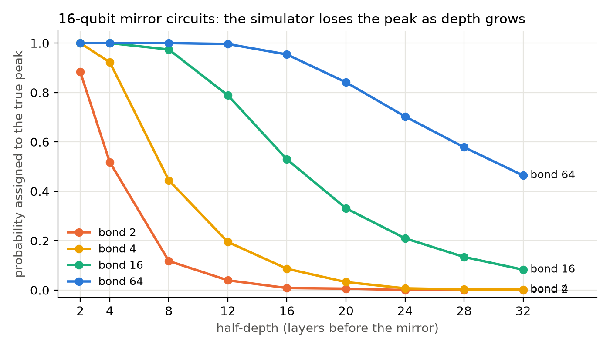
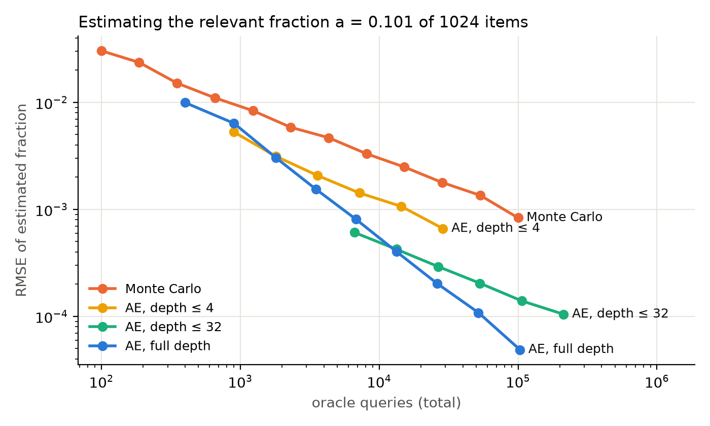

# Simulating peaked circuits with a matrix product state

This is a small project I did while learning quantum computing. The question is: **when can a classical computer simulate a quantum circuit, and when can it no longer keep up?**

How I got to this question:

1. I started with a recommender-system problem from my capstone (ATRS): estimate what fraction of a catalogue is relevant to a user. Simulated quantum amplitude estimation was 17 times more accurate than random sampling at the same number of queries (Part 2).
2. Then I found that when the catalogue is sorted by score, the quantum state compresses into a tensor network of 104 numbers, so a normal computer reproduces it easily. The advantage depended on how the data was arranged.
3. So I built a tensor-network (MPS) simulator and tested it on peaked circuits, which have been proposed as a test of quantum advantage (Part 1, the main part).
4. The simulator kept finding the answer long after it stopped representing the state accurately. That means the simple mirror circuits I used are too easy, and the next step is circuits that hide their structure, 2D layouts and GPU simulation.

Everything is simulated with NumPy on my laptop (Apple M4). I did not use real quantum hardware.

## Part 1: mirror circuits and the MPS simulator

A peaked circuit is a circuit that looks random but gives one particular bitstring with high probability. A quantum computer would find that bitstring just by running the circuit. I wanted to see how well a simple classical simulator can find it. The idea of peaked circuits is from Aaronson and Zhang (arXiv:2404.14493).

I used mirror circuits, which are the easiest peaked circuits to build: random two-qubit gates in a brickwork pattern (U), then the inverse (U†), then some X gates that set the answer. The exact output is the answer string with probability 1.

The simulator in `peaked.py` applies the gates one at a time and keeps at most `max_bond` singular values on each bond. It does not use the fact that the second half cancels the first half, so it has to get through the entangled state in the middle.

### Results (16 qubits)



The numbers are the probability that the simulator gives to the correct bitstring, averaged over 5 random circuits.

| Half-depth | Two-qubit gates | Entropy at the middle (bits, max 8) | Bond 2 | Bond 4 | Bond 16 | Bond 64 |
|---|---|---|---|---|---|---|
| 4 | 60 | 1.68 | 0.518 | 0.923 | 1.000 | 1.000 |
| 8 | 120 | 3.20 | 0.118 | 0.444 | 0.974 | 1.000 |
| 16 | 240 | 5.64 | 0.008 | 0.086 | 0.529 | 0.954 |
| 24 | 360 | 6.95 | 0.000 | 0.007 | 0.210 | 0.703 |
| 32 | 480 | 7.22 | 0.000 | 0.002 | 0.083 | 0.464 |

The full table is in [results/peaked.md](results/peaked.md).

Some things I noticed:

- The probability drops gradually as the circuit gets deeper. How fast it drops follows the entanglement entropy at the middle of the circuit.
- Even 0.083 is far above a random guess, which is 1/65536 for 16 qubits. So with bond 16 or 64 you can still read off the answer by sampling a few times. Bond 2 and 4 really do lose it.
- The entropy grows slowly, roughly 0.4 bits per layer at the start, and levels off around 7.2 bits.

### Run time and a bigger case

For 40 qubits and 639 gates, the run time went from 0.05 s at bond 8 to 9.0 s at bond 128. The fitted exponent was about 2. In theory the SVD cost is cubic in the bond dimension, so I think these sizes are still too small to see that.

I also ran 48 qubits with half-depth 8 and bond 64. It took 1.05 s and 4.9 MB of memory, and gave the correct bitstring probability 0.9999. A full state vector for 48 qubits would need about 4,500 TB.

### Something I got wrong at first

In my first version I only went up to half-depth 10, and I measured the "bond dimension needed" by counting the nonzero singular values. That gave 256, but bond 64 was already almost exact, because most of those singular values are tiny. Entropy is a better measure. After that I extended the depth to 32.

## Part 2: where it started, amplitude estimation vs Monte Carlo

This was my first experiment. It is smaller and mostly reproduces known results, but its last finding is what led to Part 1.

The problem: some fraction *a* of the items in a catalogue are relevant to a user (similarity above a threshold). Estimate *a* with as few queries as possible. I used 1024 synthetic items with *a* ≈ 0.1.

The estimator is maximum likelihood amplitude estimation (Suzuki et al. 2020). I also tried limiting the number of Grover iterations per circuit, since deep circuits are hard to run on real devices.



| Method | Fitted error scaling | RMSE at about 100,000 queries |
|---|---|---|
| Monte Carlo | queries^−0.50 | 8.3×10⁻⁴ |
| AE, depth ≤ 32 | queries^−0.51 | 1.4×10⁻⁴ |
| AE, full depth | queries^−0.98 | 4.9×10⁻⁵ |

At the same number of queries, full-depth AE was about 17 times more accurate than Monte Carlo. With the depth limited to 32 it was about 6 times more accurate, but the slope went back to −0.5.

Two other experiments in this part:

- I ran 32 independent circuits with multiprocessing. For a 16-qubit state (0.5 MB) the speedup on 4 workers was 3.9×. For a 22-qubit state (32 MB) it was only 1.8×. My guess is memory bandwidth, but I did not measure it.
- I converted the Grover state to an MPS. If the relevant items are at random positions, the bond dimension is 128, which is the maximum for 14 qubits. If the catalogue is sorted so the relevant items are one block, the bond dimension is 2, so that case is easy to simulate classically.

The numbers are in [results/results.md](results/results.md).

## How to run

```bash
conda env create -f environment.yml && conda activate qae-practice
python run_peaked.py        # part 1, about 35 s
python run_experiments.py   # part 2, about 30 s
pytest                      # 10 tests
```

## Files

```
peaked.py            mirror circuits, statevector simulator, MPS simulator
run_peaked.py        experiments for part 1
qae.py               Grover circuit, MLAE, Qibo version of the circuit, MPS compression
run_experiments.py   experiments for part 2
tests/               MPS vs exact state, GHZ bond dimension, NumPy vs Qibo
results/             figures and tables
docs/                notes for my application
```

## Limitations

- Mirror circuits are much easier than the peaked circuits in the papers. Those hide the structure, and they run on hardware where any two qubits can interact. I have not implemented those yet.
- The circuits are 1D only. I expect entanglement to grow faster in 2D.
- The main table uses 16 qubits and 5 circuits per depth, with no noise.
- In part 2 the oracle is free, which would not be true on real hardware. That part mostly reproduces known results.

## Next steps

- Implement the peaked circuit construction from the Aaronson and Zhang paper for 8 to 12 qubits.
- Check my simulator against quimb.
- Try 2D circuits, and move the SVDs to a GPU.

## References

- S. Aaronson, Y. Zhang. On verifiable quantum advantage with peaked circuit sampling. [arXiv:2404.14493](https://arxiv.org/abs/2404.14493)
- H. Gharibyan et al. Heuristic quantum advantage with peaked circuits. [arXiv:2510.25838](https://arxiv.org/abs/2510.25838)
- Y. Suzuki et al. Amplitude estimation without phase estimation. Quantum Information Processing 19, 75 (2020)
- D.-L. Vu, B. Cheng, P. Rebentrost. Low depth amplitude estimation without really trying. [arXiv:2410.01173](https://arxiv.org/abs/2410.01173)
